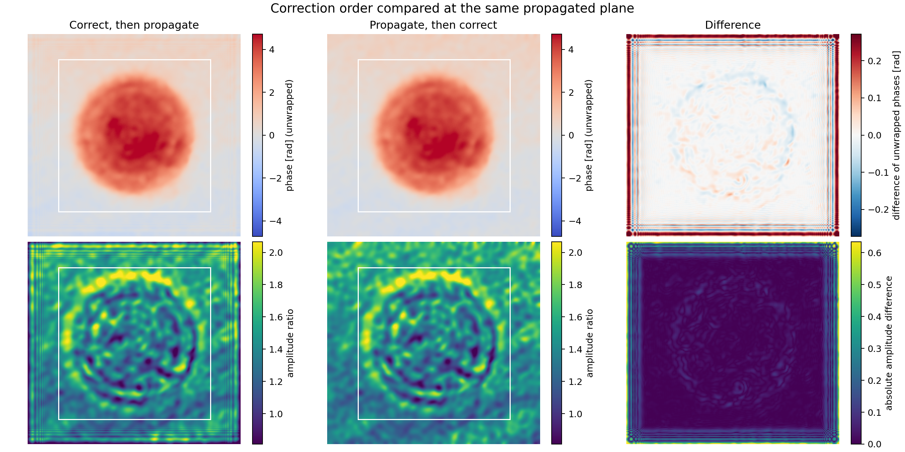

.. _sec_fourier_domain_pipeline:

=======================
Fourier Domain Pipeline
=======================

Since version 0.7.0, :meth:`.OffAxisHologram.run_pipeline` accepts an
``output_domain`` keyword argument. By default (``output_domain="spatial"``) the
pipeline returns the reconstructed complex field as usual. When
``output_domain="fourier"`` is set, the inverse FFT is skipped and a
:class:`~qpretrieve.fourier.fourier_field_data.FourierFieldData` is returned instead.

The :class:`~qpretrieve.fourier.fourier_field_data.FourierFieldData` holds the
filtered Fourier data and all the metadata needed to reconstruct the spatial field.
Calling its :meth:`~qpretrieve.fourier.fourier_field_data.FourierFieldData.finalize`
method performs the inverse FFT and returns the spatial field identically to the
default path.

Spatial Output (Default)
------------------------

.. code-block:: python

    import numpy as np
    import qpretrieve

    edata = np.load("examples/data/hologram_cell.npz")
    oah = qpretrieve.OffAxisHologram(edata["data"])
    field = oah.run_pipeline()      # returns complex spatial field
    print(type(field))              # numpy.ndarray
    print(field.shape)              # (1, H, W)

Fourier Output (skipping the inverse FFT)
-----------------------------------------

This is useful when combined with field propagation, see the Note above.

.. code-block:: python

    import numpy as np
    import qpretrieve

    edata = np.load("examples/data/hologram_cell.npz")
    oah = qpretrieve.OffAxisHologram(edata["data"])
    fourier_data = oah.run_pipeline(output_domain="fourier")

    # The fourier_data carries the filtered Fourier data.
    # Call finalize() to recover the spatial field when needed.
    field = fourier_data.finalize()
    print(field.shape)              # (1, H, W) — identical to the default path

.. admonition:: Combining `qpretrieve` and `nrefocus` pipelines

    The Fourier output is most useful when the result is passed directly to a
    wave propagation library such as `nrefocus
    <https://nrefocus.readthedocs.io>`_, which can consume the
    :class:`~qpretrieve.fourier.fourier_field_data.FourierFieldData` object and
    skip its own forward FFT. This avoids a redundant iFFT + FFT pair at the
    qpretrieve/nrefocus boundary.
    For an nrefocus-integrated working example see the :ref:`sec_examples` and for background correction specifically see below.

    *Comparing Spatial vs. Fourier Pipeline*

    For unpadded, square spatial input data, the default spatial domain
    pipeline and the fourier domain pipeline are identical. There is only
    floating point imprecision.
    For padded pipelines, the pipelines are not identical due to padding and
    unpadding causing inconsistencies at the boundary of the images.

Background Correction
---------------------
There is no Fourier-domain background correction built into `qretrieve`.

- If you need background correction, then run the iFFT as default and do background correction: real-space sample field/background field.
- If you do not need background correction, use the direct FFT method when you need numerical propagation.

This example compares two orders of background correction at the same
propagated plane:

1. Inverse-transform the sample and background, divide the spatial fields,
   then propagate the corrected field.
2. Propagate both Fourier fields, inverse-transform them, then divide the
   propagated fields.

The first order seems to be faster with the current implementations.
Therefore, if you need background subtraction, then use the first order
(correct then propagate).

The two orders can differ because propagation and pointwise division do not
generally commute. The first path zero-pads the corrected spatial field to the
same FFT grid used by the second path; differences near the image boundary can
reflect that boundary assumption. Each phase map is unwrapped with
scikit-image before display. The phase difference panel is the difference of
those two unwrapped maps; the difference map itself is not unwrapped again.

The plot marks a centered 150×150 pixel square ROI on the object. The table
below reports the phase and amplitude statistics in that ROI, including the
statistics of the difference maps.

          plane, with phase and amplitude difference maps and a square object ROI.
    :width: 100%

Generate the figure and print the RST table with :download:`this script
<../examples/compare_spatial_and_propagated_background.py>`::

    python examples/compare_spatial_and_propagated_background.py

.. list-table:: Statistics within the centered 150×150 pixel object ROI
   :header-rows: 1

   * - Statistic
     - Correct, then propagate
     - Propagate, then correct
     - Change / difference map
   * - Phase mean [rad]
     - 1.8653
     - 1.8645
     - -0.0007
   * - Phase standard deviation [rad]
     - 1.6798
     - 1.6804
     - 0.0007
   * - Amplitude ratio mean
     - 1.4456
     - 1.4456
     - 0.0000
   * - Amplitude ratio standard deviation
     - 0.2515
     - 0.2504
     - -0.0011
   * - Phase difference map mean ± SD [rad]
     - —
     - —
     - -0.0007 ± 0.0140
   * - Amplitude difference map mean ± SD
     - —
     - —
     - 0.0126 ± 0.0131
